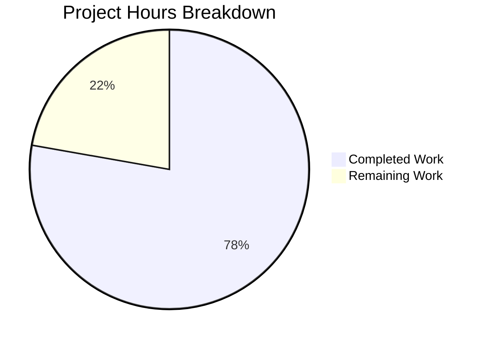

# 1. Executive Summary

## 1.1 Project Overview

`Welcome to Blitzy` is a minimal Node.js program: one script at the repository root whose entire behaviour is writing the exact string `Welcome to Blitzy` to standard output, delivered alongside a short README. It takes no input, holds no state, reads no configuration and exposes no service or user interface — it runs once as `node index.js` and exits with status 0. Its users are the developer who runs it and any harness that checks the printed line. The technical scope is two files, the removal of the tutorial project that previously occupied the repository, and no dependency, manifest, lockfile, build or test artefact.

## 1.2 Completion Status

**7.0 hours completed out of 9.0 total hours = 78% complete** (7.0 ÷ 9.0 × 100 = 77.8%, rounded to 78%).



| Metric | Hours |
|---|---|
| Total Hours | 9.0 |
| Completed Hours (AI + Manual) | 7.0 |
| Remaining Hours | 2.0 |

## 1.3 Key Accomplishments

- A two-line entry script at the repository root prints exactly `Welcome to Blitzy`, unformatted, exiting 0.
- The source opens with the required single-line JSDoc summary and carries no tags.
- A four-line README documents installation and the run command, inside the five-line cap.
- The program runs with nothing installed: no manifest, lockfile, dependency or build step.
- The repository holds exactly the two delivered files, with no residue of the superseded tutorial.
- Output is deterministic and unaffected by arguments, stdin, environment, locale or colour settings.
- No service surface exists: no port is bound and no endpoint answers.
- No security surface: no secrets, input path, dynamic loading or network access.

## 1.4 Critical Unresolved Issues

**2 of the 28 requirements this work was scoped against remain open — both partially met by the removal of the pre-existing project.** Two further items stand between this state and release: the acceptance sign-off below, and one accepted caveat that needs no action.

| Issue | Impact | Owner | ETA |
|---|---|---|---|
| The pre-existing tutorial project that the change removed awaits a decision | Its server sources, test suite, manifest and documentation are no longer in the tree; they remain readable in the repository history | Repository owner | 1.0 h if it is to be restored |
| Independent sign-off of the delivered files and of the documented run line from a clean checkout | Release acceptance rests on this review; nothing inside the repository asserts the output | Repository owner | 0.5 h |
| A write failure is silent: with stdout closed or unwritable the program exits 0 with empty stderr (accepted caveat, no action possible) | A consumer cannot distinguish a delivered line from a discarded one | Repository owner | None — handling is excluded by the requirements |

## 1.5 Access Issues

No access issues identified. The program needs no credential, service, database or network access to run or to be verified, and the branch is published with the remote holding the delivered commit.

## 1.6 Recommended Next Steps

1. [High] Sign off both delivered files against the agreed contents and run `node index.js` from a clean checkout, confirming 18 bytes on stdout and exit status 0.
2. [High] Decide whether the tutorial project is to be retained; if it is, restore it from the repository history and reconcile the README.
3. [Medium] Add an output check outside the repository, since the repository deliberately carries no test suite.
4. [Medium] Update any external tooling or documentation that still calls `npm start`, `npm test` or the former HTTP endpoint.
5. [Low] Record the silent-write caveat wherever the printed line is consumed.

# 2. Project Hours Breakdown

## 2.1 Completed Work Detail

| Component | Hours | Description |
|---|---|---|
| The print program — `index.js` (FR1, FR2, FR4; NFR1, NFR3, NFR4) | 2.0 | The two-line entry script: the single-line JSDoc summary and one print statement writing `Welcome to Blitzy` verbatim, with no dependency, manifest or build step |
| The run documentation — `README.md` (FR3) | 0.5 | Title, install line and run line, under the five-line cap, with no further section |
| Repository alignment to the delivered structure (AAP 0.6.1; constraints 1, 2, 6) | 2.5 | Reducing the tree to the two delivered files: the superseded tutorial's server sources, test suite, manifest, lockfile and archived status document removed, and the npm-oriented `.gitignore` dropped |
| Runtime verification of the output contract (FR1, NFR4; AAP 0.5.1) | 1.0 | Byte-exact stdout, exit status, stderr discipline, determinism, and insensitivity to arguments, stdin, environment, locale and colour settings |
| Integration and publication of the delivered change (AAP 0.8.2) | 1.0 | Consolidating the delivery into one branch state, re-running the tree's gates on the combined tree and publishing it |
| **Total** | **7.0** | Completed hours, matching Section 1.2 |

## 2.2 Remaining Work Detail

| Category | Hours | Priority |
|---|---|---|
| Owner decision on the pre-existing tutorial project the change removed — accept the removal, or restore it from history and reconcile the README so the two-file structure still holds | 1.0 | Medium |
| Independent sign-off that the delivered files match the agreed contents and that the documented run line works from a clean checkout | 0.5 | High |
| Re-verification of the printed line after any future change to the tree, since the repository carries no automated test by design | 0.5 | Low |
| **Total** | **2.0** | Remaining hours, matching Section 1.2 and Section 7 |

## 2.3 Hours Basis and Confidence

Hours are estimated from the work the deliverable actually required: two files written to a fixed specification, the reduction of the repository from a tutorial project to the two-file deliverable, and the runtime verification of the output contract. Completed hours carry **high confidence** — every item is traceable to a delivered artefact and was verified first-hand, from the byte content of both files to the printed line, its exit status and its insensitivity to environment and input. Remaining hours carry **medium confidence**: the sign-off and the external output check are bounded and known, while the 1.0 h restore contingency depends on an owner decision and would grow only if the tutorial were also to be re-documented.

The arithmetic is consistent across the document: 7.0 completed + 2.0 remaining = **9.0 total project hours**; 7.0 ÷ 9.0 × 100 = 77.8%, stated as **78% complete** in Sections 1.2, 7 and 8.

# 3. Test Results

The repository ships no test suite, so every result below is a direct execution or a byte-level check run against the delivered tree; no result here comes from an assertion file, and no pass rate is inferred from one.

| Area / Category | Framework | Tests | Passed | Failed | Coverage | What This Proves |
|---|---|---|---|---|---|---|
| Printed line — stdout, stderr, exit status | Direct execution (no assertion framework configured) | 4 executions | 4 | 0 | Not measured — no coverage tooling exists in the project | Running the program writes exactly `Welcome to Blitzy` plus one newline, exits 0 and writes nothing to stderr |
| Byte-level output contract | `cmp` against the expected 18 bytes, `od -c`, `sha256sum` | 3 checks | 3 | 0 | — | The output is byte-identical to the agreed string, with no colour, prefix, padding, banner or decoration |
| Entry resolution | Direct execution (`node index.js`, `node .`, and a directory holding only `index.js`) | 3 invocations | 3 | 0 | — | The file at the repository root is the entry the README names, and it needs no install, manifest or companion file |
| Determinism and input/environment insensitivity | Direct execution (repeat runs, emptied environment, extra arguments, `PORT`/`HOST` override) | 6 variants | 6 | 0 | — | Output does not vary between runs and is unaffected by arguments, environment or the removed service's configuration |
| Syntax gate over the source | `node --check` | 1 file | 1 | 0 | `index.js` is the tree's only JavaScript file | Every source file in the repository parses cleanly |
| Automated test suite | `node --test` | 0 tests discovered | 0 | 0 | — | The repository ships no test suite; the constraint that forbids one makes the exact file contents the acceptance criterion instead |
| Package-level commands | `npm ci`, `npm test`, `npm audit` | 3 commands | 0 | 3 (by design) | — | These commands require a manifest and a lockfile the deliverable deliberately does not ship; they return EUSAGE, ENOENT and ENOLOCK and execute nothing |
| Network surface | `lsof` listener probe and an HTTP probe of the former tutorial port | 2 probes | 2 | 0 | — | Nothing binds a port, and the endpoint this repository used to serve refuses connections |

### Not Covered

- **Automated regression protection for the printed line.** No test suite, assertion or coverage tooling exists inside the repository — the same constraints that fix the acceptance criterion at the file contents also forbid adding one. Before release, and after any future change to `index.js` or the README, a human should run the program and compare its output bytes with the agreed string (`printf 'Welcome to Blitzy\n' | cmp - <(node index.js)`).
- **The pre-existing tutorial project.** Its HTTP route with its 404 and 405 paths, its `PORT`/`HOST` configuration reads and its test suite are no longer in the tree, so none of that behaviour can be re-exercised from this repository. Anyone who needs it must restore it from the repository history and run its own suite.
- **Browser-driven and endpoint-driven validation.** The program renders no page, serves no route and exposes no interface, so no screen, form or request was driven — there is nothing of that kind to cover.

# 4. Runtime Validation &amp; UI Verification

- ✅ **Program execution** — `node index.js` from the repository root: stdout exactly 18 bytes (`Welcome to Blitzy` plus one newline), empty stderr, exit status 0.
- ✅ **Alternate entry forms** — `node .`, an absolute path and a directory containing only `index.js`: identical bytes and exit status.
- ✅ **Byte-level contract** — output `cmp`-identical to the agreed 18 bytes, with no escape, colour, padding or banner bytes.
- ✅ **Determinism** — repeated runs produce a single identical digest, including under an emptied environment.
- ✅ **Input isolation** — extra arguments, `--help`, `-v` and piped stdin leave the output unchanged.
- ✅ **Environment isolation** — `PORT=9999 HOST=0.0.0.0`, an empty environment and locale variations change nothing; no environment variable is read.
- ✅ **No side effects** — the working tree is unchanged after every run; no file is written, no socket is opened and no process is left behind.
- ✅ **No service surface** — zero listening sockets, and the endpoint this repository used to serve refuses connections.
- ⚠ **Unwritable stdout** — with a closed pipe or an unwritable device the program still exits 0 with empty stderr, so a dropped write is silent; this follows directly from the requirements and is carried as an accepted caveat in Section 6.
- ❌ **Browser and UI verification** — not applicable and not performed: this program renders no page, serves no route and exposes no interface, so there is no screen, form, endpoint or client to drive. No screenshot or recording exists, and none could be taken.

Nothing the program does was left unexercised: its entire behaviour — one stdout write — is what every check above drives, and it was run under both the installed Node.js v24.21.0 and the v22.23.3 interpreter present on the host with identical results. The only runtime surface left unexercised is the one the change removed: the former HTTP endpoint and its test suite no longer exist in the tree.

# 5. Compliance &amp; Quality Review

## 5.1 Compliance Matrix

| # | Requirement | Source | Verified Now | Status |
|---|---|---|---|---|
| 1 | Running the program writes exactly `Welcome to Blitzy`, verbatim and unformatted | FR1 | `index.js:2`; stdout byte-verified at 18 bytes with no decoration | ✅ Pass |
| 2 | A single-line JSDoc summary, with no `@param`, `@returns`, extra paragraph or example | FR2; constraints 3-4 | `index.js:1`; one comment line in the entire tree; no tag anywhere | ✅ Pass |
| 3 | README under five lines: title plus install and run lines, no other section | FR3; constraint 5 | `README.md` 4 lines / 110 bytes; no further section, badge or table of contents | ✅ Pass |
| 4 | Plain JavaScript the runtime executes directly, at the repository root | FR4 | `node --check index.js` exit 0; runs as `node index.js` and `node .` | ✅ Pass |
| 5 | Fewest lines and least token cost | NFR1 | `index.js` 2 lines / 69 bytes, one summary and one statement | ✅ Pass |
| 6 | No runtime dependency, manifest, lockfile or build step | NFR2; constraint 6 | None exists in the tree; no `require`, `import` or `export` in the source | ✅ Pass |
| 7 | No hardening: no error handling, logging, configuration, retry or validation | NFR3; constraint 7 | No handler, log sink, validation or environment read in the source | ✅ Pass |
| 8 | Deterministic: one stdout write, exit status 0, no file-system, network, environment or process-input access | NFR4 | Repeat, emptied-environment and variant runs identical; zero listeners; tree unchanged after runs | ✅ Pass |
| 9 | The exact file contents are the acceptance criterion | AAP 0.5.1 | Both files byte-identical to the agreed contents (`cmp` identical) | ✅ Pass |
| 10 | The tree holds exactly the two delivered files | AAP 0.6.1; constraint 2 | `git ls-files` = `README.md`, `index.js`; no forbidden artefact of any kind | ✅ Pass |
| 11 | No pre-existing file updated or deleted; smallest possible diff | AAP 0.7.1; constraint 1 | README replaced in place and seven pre-existing paths removed | ⚠ Diverged — see D1 |
| 12 | Plan authoring and acceptance constraints: concise plan, bounded research, final decisions only, no verification section in the plan, boundary stated once | Constraints 8-13 | Met as the AAP records them; the acceptance criterion itself is verified in row 9 | ✅ Pass |

## 5.2 AAP & Rule Divergences and Gaps

| # | What the AAP/Rule Required | What Was Delivered Instead | Why It Diverged | Impact | Remediation |
|---|---|---|---|---|---|
| D1 | "No file is updated, deleted or referenced"; "Both entries are creations"; smallest possible diff with no unrelated changes to existing code | `README.md` replaced in place (3 insertions / 977 deletions), and `.gitignore`, `package.json`, `package-lock.json`, `src/app.js`, `src/server.js`, `test/app.test.js` and `blitzy/documentation/Project Guide.md` deleted | The AAP's stated starting point was out of date: the repository already held an HTTP hello tutorial. The AAP's own structure requirement (exactly `index.js` and `README.md`) and the user's README cap of under five lines cannot hold alongside that content | The tutorial is no longer in the tree; it remains readable in the repository history. No delivered behaviour changes | Accept the removal, or restore the tutorial from the base commit `7584c85` and reconcile the README (1.0 h) |
| D2 | `README.md` is "three lines" | `README.md` is four physical lines / 110 bytes: title, blank separator, install line, run line | The AAP's own verbatim block — the stated acceptance criterion — contains the blank separator line, and its cap is "under 5 lines"; the file is byte-identical to that block | None; a mechanical three-line check would misread a compliant file | None required |
| D3 | The executing runtime is Node.js 22.23.3 | The work was built and verified on the host's default Node.js v24.21.0, and the program was also run under the v22.23.3 interpreter present at `/usr/bin/node`; the tree pins no version | The host's default interpreter differs from the AAP's statement; the program uses only the built-in print facility and depends on no version-specific behaviour | None — verified identical output on both interpreters | None required; pinning a version would need a manifest the constraints forbid |

**D1 — pre-existing repository content replaced and removed.** The AAP was written for an empty repository: it fixes two creations and states that nothing else is touched. The repository instead held a working HTTP "hello" tutorial — server sources, a route with 404 and 405 paths, `PORT`/`HOST` configuration, an eight-case test suite, a manifest declaring `engines: node >=24`, a lockfile, a 978-line tutorial README and an archived status document. Delivering the two-file program with a README under five lines is impossible alongside that content, so `README.md` was replaced in place (`2fb2383`) and the tutorial's files removed (`5b239d3`, `922a591`). Everything removed is still readable at base commit `7584c85`. The owner must decide: accept the reduction, or restore the project and reconcile the two documents.

**D2 — the README's physical line count.** The prose that describes the README in the AAP calls it three lines; the file has four, because the block the same section declares the acceptance criterion shows a blank separator between the title and the install line. Markdown needs that blank line for the title to render as a heading, and the stated cap is "under 5 lines", which four satisfies. The delivered file is byte-identical to that block (`README.md:1-4`). No action is required; a reviewer running `wc -l` should expect 4.

**D3 — the runtime the work ran on.** The AAP names Node.js 22.23.3 as the executing runtime. The host's default interpreter is v24.21.0 and is what the delivered work was verified on, while v22.23.3 also exists on the host and runs the program byte-identically (`/usr/bin/node index.js` → `Welcome to Blitzy`, exit 0). Nothing in either delivered file depends on the version: the program calls one built-in, and the README names no version. Pinning one would require a package manifest, which the user's constraint against dependencies, lockfiles and manifests forbids, so the divergence needs no remediation.

Nothing else departs from the AAP or the user's rules: apart from the smallest-diff rule that D1 engages, every requirement — including the other twelve inline constraints — is satisfied on the delivered tree, and the delivered files match the agreed contents byte for byte.

# 6. Risk Assessment

| Risk | Category | Severity | Probability | Mitigation | Status |
|---|---|---|---|---|---|
| Nothing inside the repository asserts the printed line, so a future edit to `index.js` or the README could break the contract unnoticed | Technical | Medium | Medium | Keep a one-line byte comparison of the output outside the repository and run it after any change; the acceptance criterion remains the exact file contents | Open |
| A write failure is silent: with stdout closed, a full device or an early-closing reader the program exits 0 with empty stderr | Technical | Low | Low | Consumers compare the bytes they received rather than relying on exit status; handling is excluded by the no-hardening and exit-0 requirements | Accepted caveat |
| The pre-existing tutorial project exists only in the repository history, so it cannot be run or extended from the delivered tree | Operational | Medium | Medium | Owner decision: accept the reduction, or restore from base commit `7584c85` and reconcile the README | Open |
| The tree pins no runtime version, and the documented command resolves `node` through the environment's `PATH` | Integration | Low | Low | Run on a maintained Node.js release; the program uses only the built-in print facility and was verified on v24.21.0 and v22.23.3 | Accepted |
| Tooling outside the repository that still calls `npm start`, `npm test` or the former HTTP endpoint now fails — npm exits 254 with ENOENT because no manifest exists, and the endpoint refuses connections | Integration | Medium | Medium | Update external callers and documentation; the README names only `node index.js` | Open (outside the repository) |
| The removed tutorial code, its manifest and its archived status document remain readable to anyone with repository-history access | Security | Low | Low | None needed: credential, token, internal-path and PII sweeps over that material returned no sensitive content | Accepted |
| Credential-shaped variables exist in the runtime environment while the program reads no environment variable at all | Security | Low | Low | Re-run a leak check if a future change ever introduces an environment read | Accepted (monitoring) |

No risk here prevents the delivered program from running exactly as specified: the printed line, the entry contract, the tree shape and the documented run command are all verified. Every open item in this list is either an owner decision recorded in Section 1.4 or a caveat the requirements deliberately accept.

# 7. Visual Project Status


*Chart legend: Completed Work — Dark Blue (#5B39F3); Remaining Work — White (#FFFFFF).*

| Progress Measure | Value |
|---|---|
| Total project hours | 9.0 |
| Completed hours | 7.0 |
| Remaining hours | 2.0 |
| Completion | 78% |
| Requirements met | 26 of 28 |
| Requirements partially met | 2 of 28 |
| Requirements not started | 0 of 28 |

**Remaining work by category** (identical to Section 2.2):

| Category | Hours | Priority |
|---|---|---|
| Owner decision on the removed tutorial project — accept, or restore and reconcile | 1.0 | Medium |
| Independent sign-off of the delivered files and the documented run line | 0.5 | High |
| Post-change re-verification of the printed line | 0.5 | Low |
| **Total** | **2.0** | |

Completion is measured in hours: 7.0 of 9.0 total hours, or 78%. The requirement counts describe how many of the 28 scoped requirements the delivered tree satisfies; the two partially met ones both stem from the single divergence recorded as D1 in Section 5.2 — the change replaced and removed pre-existing repository content that the AAP, written for an empty repository, said would not be touched.

# 8. Summary &amp; Recommendations

The repository now delivers exactly what was asked of it: a two-line Node.js program at the root whose single behaviour is writing `Welcome to Blitzy` to standard output, and a four-line README that documents installation and the run command. Both files match the agreed contents byte for byte, the tree holds nothing else, and the tutorial project that previously occupied the repository is gone, leaving no dangling reference. Of the 28 requirements this work was scoped against, 26 are met outright and 2 are partially met for a single reason: the change replaced and removed pre-existing content that the AAP, written for an empty repository, said would not be touched.

Everything the program does has been exercised and observed rather than assumed. Direct execution produces exactly 18 bytes on stdout — the string plus one newline — with an empty stderr and exit status 0; `node .`, an absolute path and a directory containing only `index.js` behave identically; repeated runs produce one identical digest; and extra arguments, piped stdin, an emptied environment, an injected `PORT`/`HOST` and locale or colour settings change nothing. The program binds no socket, writes no file, leaves the working tree untouched and runs identically under the host's Node.js v24.21.0 and v22.23.3. Because the constraints forbid a test suite, no assertion of that contract exists inside the repository: the acceptance criterion is the exact file contents, and the checks above are direct executions.

Three items stand between this state and release (Section 1.4). The first is the owner's decision on the removed tutorial project — accept the reduction, or restore it from the repository history and reconcile the README, about an hour's work. The second is independent sign-off that the delivered files match the agreed contents and that the documented command works from a clean checkout. The third is an output check living outside the repository, since nothing inside it will catch a future edit that breaks the printed line. On the hours basis, 7.0 of 9.0 total hours are complete — **78%** (Section 1.2).

**Production readiness: ready for what it declares.** This is a prototype-grade console program with a fixed contract, no dependency, no configuration and no service surface, and it is appropriate at exactly the scale it declares — it runs anywhere a Node.js runtime exists, with nothing installed. Two properties should be known before it is embedded in anything larger: a write failure is silent (a closed pipe or full device still yields exit status 0 with no stderr), and the repository carries no automated protection for the printed line. Both are direct consequences of the constraints this work was given, not defects, and both are recorded with their mitigations in Section 6. Success for this delivery is simple to measure: the agreed contents in place, one exact line on stdout, exit status 0, and nothing else in the repository.

| Success Metric | Target | Observed |
|---|---|---|
| Stdout of the documented command | Exactly `Welcome to Blitzy` plus one newline, 18 bytes | ✅ 18 bytes, sha256 `2dc7e85a…` |
| Exit status on the documented command | 0 | ✅ 0 |
| Stderr | Empty | ✅ 0 bytes |
| Files in the repository | Exactly the two delivered files | ✅ `README.md`, `index.js` |
| Dependencies, manifest, lockfile, build | None | ✅ None |
| Service, network or endpoint surface | None | ✅ Zero listeners; former endpoint refuses |

# 9. Development Guide

## 9.1 System Prerequisites

- **Node.js runtime** — any maintained release. Verified on the host's default Node.js **v24.21.0** and on the **v22.23.3** interpreter present at `/usr/bin/node`; both print the same bytes with exit status 0.
- **Nothing else.** No package manager, compiler, transpiler, database, message broker, container runtime or web server is involved.
- **Operating system** — any platform the Node.js runtime supports; the commands below use a POSIX shell.
- **Hardware** — negligible: the program allocates one short string, writes it and exits.

## 9.2 Environment Setup

No setup is required. There is no configuration file, no virtual environment and no environment variable that the program reads: it produces the same output under an emptied environment (`env -i`) as under the full one. Every command below is run from the repository root, so start there:

```bash
cd "$(git rev-parse --show-toplevel)"
```

## 9.3 Dependency Installation

There is nothing to install. The project declares no dependency, ships no package manifest and no lockfile, and creates no module directory — the whole program is one file that uses only the runtime's built-in print facility. If you copy `index.js` on its own into an empty directory it still runs.

Because no manifest exists, the package-manager commands have nothing to work with: `npm ci` exits 1 (`EUSAGE`, no lockfile), `npm test` exits 254 (`ENOENT`, no `package.json`) and `npm audit` exits 1 (`ENOLOCK`). That is the intended state, not a broken checkout — there is nothing to install and no script to run.

## 9.4 Running the Application

```bash
node index.js
```

Expected output:

```
Welcome to Blitzy
```

and exit status `0`, with nothing on stderr. Equivalent forms, all verified:

```bash
node .                      # a directory with no manifest resolves to index.js
node ./index.js
node /absolute/path/to/index.js
```

There is no server to start, no port to open and no background process to stop — the program runs to completion in milliseconds and exits. Do not start it as a daemon; there is nothing to serve.

## 9.5 Verifying the Installation

Run these from the repository root and compare against the expected results:

| Command | Expected |
|---|---|
| `node --version` | The runtime version, e.g. `v24.21.0` |
| `node --check index.js` | No output, exit status 0 |
| `node index.js` | `Welcome to Blitzy`, exit status 0 |
| `node index.js \| wc -c` | `18` |
| `printf 'Welcome to Blitzy\n' \| cmp - <(node index.js) && echo IDENTICAL` | `IDENTICAL` |
| `CI=true node --test` | `tests 0`, exit status 0 — no test suite ships with this project |
| `git ls-files` | `README.md`, `index.js` |

```bash
node --check index.js && node index.js | wc -c
```

That single line checks the source parses and that the output is exactly the 18 bytes the README promises.

## 9.6 Example Usage

Run the program and read the line:

```bash
node index.js
```

Capture it in a script — command substitution strips the trailing newline, so compare against the bare string:

```bash
line=$(node index.js)
if [ "$line" = "Welcome to Blitzy" ]; then echo "output verified"; fi
```

Call it from another program and check the exit status as well as the text:

```bash
node index.js > out.txt 2> err.txt
test "$(cat out.txt)" = "Welcome to Blitzy" && test ! -s err.txt && echo "ok"
```

## 9.7 Troubleshooting

| Symptom | Cause | Resolution |
|---|---|---|
| `npm error code ENOENT … open '…/package.json'`, exit 254 | No manifest exists — the project deliberately ships none | Run `node index.js` directly; there is no npm script |
| `npm ci` exits 1 with `EUSAGE`, or `npm audit` exits 1 with `ENOLOCK` | No lockfile exists — the project declares no dependency | Skip these commands; nothing needs installing |
| `node --test` prints `tests 0` | No test suite ships with this project | Verify by running the program and comparing its output bytes |
| `node .` prints the message instead of starting something | A directory with no manifest resolves to `index.js` | Expected behaviour, not an error |
| Output appears empty or truncated in a pipeline | A consumer that closed the pipe early, or stdout pointed at an unwritable target; the program exits 0 silently in that case | Make sure the consumer reads all 18 bytes; treat the received bytes, not the exit status, as proof of delivery |
| `node: command not found` | No runtime on `PATH` | Install Node.js; nothing else is required |
| Output differs from `Welcome to Blitzy` | The source file no longer matches the agreed contents | Compare `index.js` with the agreed two lines and re-run the byte check above |

## 9.8 Repository Layout

```
/
├── index.js     # the two-line program: one JSDoc summary, one print statement
└── README.md    # title, install line, run line
```

# 10. Appendices

## Appendix A — Command Reference

| Command | Purpose | Expected Result |
|---|---|---|
| `node index.js` | Run the program (the command the README documents) | `Welcome to Blitzy`, exit status 0, empty stderr |
| `node .` | Run it through directory resolution | Identical output |
| `node --check index.js` | Syntax gate over the source | No output, exit status 0 |
| `node index.js \| wc -c` | Check the output length | `18` |
| `printf 'Welcome to Blitzy\n' \| cmp - <(node index.js)` | Byte-compare the output with the agreed string | No output; `IDENTICAL` when wrapped in `&& echo IDENTICAL` |
| `CI=true node --test` | Show the automated test inventory | `tests 0`, exit status 0 — no suite ships |
| `git ls-files` | List the tracked files | `README.md`, `index.js` |
| `wc -l -c index.js README.md` | Check file sizes | `2 / 69` and `4 / 110` |
| `lsof -nP -iTCP -sTCP:LISTEN` | Confirm no service surface | No rows |
| `CI=true npm ci` / `npm test` / `npm audit` | Show that no package layer exists | Exit 1 / 254 / 1 — expected without a manifest and lockfile |

## Appendix B — Port Reference

The application opens **no socket and binds no port**. Nothing needs to be free, and no firewall rule is relevant.

| Port | Owner | Notes |
|---|---|---|
| None | — | The program's only output is stdout |
| 3000 / 127.0.0.1 | Unassigned | The former tutorial server's defaults; the endpoint no longer exists and connections are refused |

## Appendix C — Key File Locations

| Path | Role |
|---|---|
| `index.js` | The whole program: the single-line JSDoc summary and the print statement |
| `README.md` | Title, install line and run line |
| Repository root | The entry point is resolved by file name; no manifest declares one |

## Appendix D — Technology Versions

| Component | Version | Notes |
|---|---|---|
| Node.js (host default) | v24.21.0 | Runtime used for the delivered verification |
| Node.js (alternate interpreter) | v22.23.3 | Present at `/usr/bin/node`; runs the program identically |
| Project dependencies | None | No manifest, no lockfile, no module directory |
| Build / lint / test toolchain | None | The syntax gate is `node --check` |

## Appendix E — Environment Variable Reference

The program reads **no environment variable**. The variables the previous tutorial used are inert and setting them changes nothing.

| Variable | Effect |
|---|---|
| `PORT` | Ignored — verified with `PORT=9999` |
| `HOST` | Ignored — verified with `HOST=0.0.0.0` |
| `NODE_ENV`, locale, colour and TTY variables | No effect on the output; verified with an emptied environment |

## Appendix F — Developer Tools Guide

| Tool | Use |
|---|---|
| `node` | Run and syntax-check the program; the only tool required |
| `git` | Inspect the delivered change, file inventory and history |
| `git-lfs` | Keep installed: the repository's own `pre-push` hook invokes `git lfs pre-push`, so a push fails without it |
| `lsof`, `curl` | Optional: confirm that no port is bound and that the former endpoint refuses connections |
| `cmp`, `wc`, `od` | Optional: compare and inspect the output bytes and file sizes |

## Appendix G — Glossary

| Term | Meaning here |
|---|---|
| AAP | The Agent Action Plan — the agreed technical specification this work was held to |
| Entry point | The file the runtime executes — `index.js` at the repository root |
| stdout / stderr | The process's standard output and error streams; the program writes one line to stdout and nothing to stderr |
| Exit status | The number the process returns; `0` on every run |
| Manifest | A package descriptor such as `package.json`; this project deliberately has none |
| Lockfile | A dependency-version record; this project deliberately has none |
| Hardening | Defensive machinery — error handling, logging, validation, retries; deliberately absent by requirement |
| EPIPE | The error a process meets when a reader closes the pipe it is writing to; with stdout unwritable the program still exits 0 |
| Acceptance criterion | The fixed contents of `index.js` and `README.md` |
